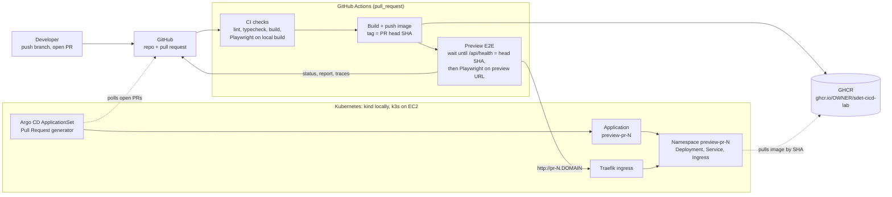

# SDET CI/CD Lab

A deliberately small Next.js task manager whose real job is to be deployed. Every pull request gets its own preview environment on Kubernetes, and a Playwright suite runs against that preview before merge. It recreates the feature-branch → preview → E2E workflow used at QA Wolf, built from scratch to learn GitHub Actions, Docker, Kubernetes, Argo CD and AWS.

> **Status:** the app and its Playwright suite are done. The infrastructure is being built one milestone at a time. See [LEARNING_PLAN.md](./LEARNING_PLAN.md).

## What the finished pipeline does

1. A developer pushes a feature branch and opens a PR labeled `preview`.
2. GitHub Actions runs CI checks: lint, typecheck, build, and Playwright against a local production build.
3. CI builds a multi-arch Docker image and pushes it to GHCR, tagged with the PR's head commit SHA.
4. Argo CD's ApplicationSet Pull Request generator sees the open PR and creates an Application named `preview-pr-<N>`.
5. Kubernetes runs that image in its own namespace, reachable at `http://pr-<N>.<domain>`.
6. CI polls the preview's `/api/health` until it reports the PR's head SHA, then runs Playwright against the preview URL.
7. Results show on the PR; the HTML report and traces are uploaded as workflow artifacts.
8. Pushing again updates the same preview in place. Closing the PR deletes its Application, namespace and everything in it.

## Architecture



### PR lifecycle

| Event                          | GitHub Actions                                                                 | Argo CD and Kubernetes                                                                                           |
| ------------------------------ | ------------------------------------------------------------------------------ | ---------------------------------------------------------------------------------------------------------------- |
| PR opened or labeled `preview` | Checks pass → image `:<head-sha>` pushed → wait for preview → Playwright       | Generator finds the PR → Application `preview-pr-N` → namespace, Deployment, Service, Ingress at `pr-N.<domain>` |
| New commit pushed              | Previous run cancelled; new image `:<new-head-sha>`; E2E waits for the new SHA | Same Application re-renders with the new tag → rolling update in the same namespace                              |
| PR closed or merged            | Optional: prune that PR's image versions                                       | Generator drops the PR → Application deleted → its resources and namespace deleted                               |

### Design decisions

- **Immutable image tags.** Images are tagged with the full 40-character PR head SHA. Nothing uses `latest` and no tag is overwritten. On `pull_request` events, `github.sha` is a temporary merge commit, so CI tags with `github.event.pull_request.head.sha`. That's the same value the Argo CD generator exposes as `head_sha`.
- **No Git commit per preview deploy.** The ApplicationSet derives the image tag from the PR's head SHA, so pushing code is the whole deploy step. Tag-bumping commits are reserved for long-lived environments.
- **One image, configured at runtime.** The app reads `APP_COMMIT_SHA` and `APP_ENVIRONMENT` per request. It doesn't use `NEXT_PUBLIC_*`, which `next build` freezes into the bundle. Docker bakes the SHA in as a default, and Kubernetes sets the environment name.
- **"Healthy" means "healthy at the right commit."** During a rolling update the old pod keeps serving and keeps passing health checks. CI polls `/api/health` until `commitSha` equals the PR head SHA, and the Playwright suite asserts it again.
- **One namespace per PR,** created and deleted with the PR's Application.
- **No DNS to manage.** Wildcard DNS from nip.io gives every preview a hostname: `pr-N.127.0.0.1.nip.io` on kind, `pr-N.<elastic-ip>.nip.io` on EC2.
- **Opt-in previews.** Only PRs labeled `preview` get an environment, which caps cost on EC2.
- **Multi-arch images.** CI builds `linux/amd64` and `linux/arm64`, so the same tag runs on kind on Apple silicon and on either EC2 architecture.

## Repository layout

```text
.
├── src/
│   ├── app/
│   │   ├── page.tsx              # Task list + streamed build badge
│   │   ├── layout.tsx
│   │   └── api/health/route.ts   # Probe + CI readiness endpoint
│   ├── components/
│   │   ├── task-manager.tsx      # Client UI: add, complete, delete
│   │   └── build-badge.tsx       # Shows environment + short SHA
│   └── lib/
│       ├── task-store.ts         # localStorage store for useSyncExternalStore
│       └── build-info.ts         # Reads APP_* env vars at request time
├── e2e/
│   ├── pages/task-page.ts        # Page object
│   ├── tasks.spec.ts             # Add, complete, delete, persist
│   └── build-info.spec.ts        # Asserts the expected commit is deployed
├── playwright.config.ts          # Local build by default, BASE_URL for remote
│
│   Planned, built during the learning plan:
├── Dockerfile, .dockerignore                 # Milestone 2
├── .github/workflows/                        # Milestones 3 and 7
├── deploy/kind/                              # Milestone 4
├── deploy/chart/                             # Milestone 4 (Helm chart)
├── deploy/argocd/                            # Milestones 5 and 6
├── scripts/wait-for-preview.ts               # Milestone 7
└── deploy/ec2/                               # Milestones 8 and 9
```

## Running it locally

Requires Node 24 (see `.nvmrc`).

```bash
npm ci
npx playwright install chromium

npm run dev          # http://localhost:3000
npm run lint
npm run typecheck
npm run build

npm run test:e2e     # builds, starts `next start`, runs the suite
npm run test:e2e:report
```

Run the same suite against anything already deployed:

```bash
BASE_URL=http://localhost:3000 EXPECTED_COMMIT_SHA=$(git rev-parse HEAD) npm run test:e2e
```

## Configuration

| Variable              | Read by              | Default | Purpose                                                              |
| --------------------- | -------------------- | ------- | -------------------------------------------------------------------- |
| `APP_COMMIT_SHA`      | App, at request time | `dev`   | Commit the running image was built from                              |
| `APP_ENVIRONMENT`     | App, at request time | `local` | Environment label shown in the badge, e.g. `pr-12`                   |
| `BASE_URL`            | Playwright           | unset   | Remote URL to test; when unset, Playwright builds and serves the app |
| `EXPECTED_COMMIT_SHA` | Playwright           | `dev`   | Commit the environment under test must report                        |

## Contracts between the app and the pipeline

- `GET /api/health` returns `200` with `Cache-Control: no-store`:

  ```json
  {
    "status": "ok",
    "commitSha": "3f9c2a1b…",
    "shortSha": "3f9c2a1",
    "environment": "pr-12"
  }
  ```

  Kubernetes readiness and liveness probes use it, and so does CI's "wait for the new commit" step.

- The build badge exposes `data-testid="build-environment"` and `data-testid="build-commit"`.
- The task form stays disabled until React hydrates, so Playwright's auto-wait can't race hydration on a slow preview.
- Tasks live in `localStorage`, so every Playwright test (a fresh browser context) starts empty, and previews need no database.

## Tech stack

Built: Next.js 16 (App Router, Cache Components), React 19, TypeScript, Tailwind CSS 4, Playwright.

Planned: Docker (Buildx, multi-arch), GitHub Actions, GitHub Container Registry, kind, Helm, Traefik, Argo CD with an ApplicationSet Pull Request generator, k3s on AWS EC2.
